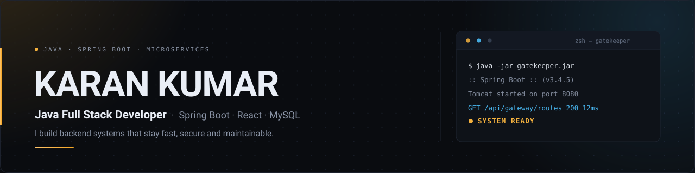
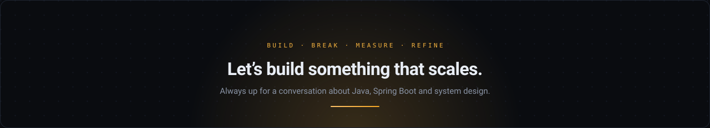

 

   

 

 

<h3 align="center">Java Full Stack Developer · Bengaluru, India</h3>

I build the part of the product most people never see — the API layer, the domain model, the transactional boundaries — and then I build the interface that proves it works.

<table>
<tr>
<td width="50%" valign="top">

**The backend is where I think.** My work centres on Java and Spring Boot: designing REST contracts, modelling relational schemas with Spring Data JPA and Hibernate, enforcing role-based access with Spring Security and JWT, and keeping service boundaries honest. I care about what happens at the edges — validation, failure paths, idempotency, transaction behaviour — because that is where real applications break.

</td>
<td width="50%" valign="top">

**Then I make it usable.** On the frontend I work with React, TypeScript, Vite and Tailwind CSS, consuming the APIs I wrote rather than mocking them. I like owning a feature end to end: schema, service, endpoint, interface, deploy.

Right now I am going deeper into distributed systems — API gateways, event-driven configuration, caching and observability — and sharpening data structures and algorithms in Java, daily.

</td>
</tr>
</table>

<table>
<tr>
<td align="center" width="25%"><b>WHAT I OPTIMISE FOR</b>  Correctness first, then latency, then ergonomics.</td>
<td align="center" width="25%"><b>HOW I WORK</b>  Small services, explicit contracts, tests around behaviour.</td>
<td align="center" width="25%"><b>WHERE I AM HEADING</b>  Backend engineering on distributed systems at real scale.</td>
<td align="center" width="25%"><b>ALWAYS DOING</b>  DSA in Java — a little every day, consistently.</td>
</tr>
</table>

<table>
<tr><td width="190" valign="middle"><b>LANGUAGES</b></td><td>

     

</td></tr>
<tr><td valign="middle"><b>BACKEND</b></td><td>

      

</td></tr>
<tr><td valign="middle"><b>FRONTEND</b></td><td>

    

</td></tr>
<tr><td valign="middle"><b>DATABASES</b></td><td>

    

</td></tr>
<tr><td valign="middle"><b>TOOLS</b></td><td>

        

</td></tr>
<tr><td valign="middle"><b>ARCHITECTURE</b></td><td>

      

</td></tr>
</table>

<b>BACKEND SERVICES</b> &nbsp;·&nbsp; <b>REST APIS</b> &nbsp;·&nbsp; <b>MICROSERVICES</b> &nbsp;·&nbsp; <b>FULL STACK PRODUCTS</b> &nbsp;·&nbsp; <b>FRONTEND INTERFACES</b>

<b>MICROSERVICES · CONTROL PLANE · BACKEND ARCHITECTURE</b>

<h3 align="center">GateKeeper — Multi-Tenant API Gateway Control Plane</h3>

<b>Spring Boot · Spring Security · JWT · Spring Data JPA · Hibernate · MySQL · Flyway · Apache Kafka · Docker Compose · Jenkins · JDK 21</b>

A three-service control plane that separates **who may configure an API** from **how a gateway discovers that configuration** — so changing one tenant's integration never means hand-editing every gateway config.

<table>
<tr>
<td width="50%" valign="top">

**Architecture**
- **API Management** `:8081` — organisations, tenant admins, versioned routes, audit trail
- **Smart Gateway** `:8080` — fetches active routes at startup, refreshes on Kafka events
- **Analytics** `:8082` — service health surface

</td>
<td width="50%" valign="top">

**Engineering highlights**
- BCrypt verification and role-based endpoints behind signed JWTs; tenant identity is derived from the token, never from a caller-supplied tenant ID
- Flyway migrations as the single schema authority; Hibernate validates, never creates
- Versioned route snapshots, per-tenant history and control-plane audit records
- Kafka after-commit notifications (`GATEWAY_CONFIGURATION_CHANGED`) trigger a full route refetch
- Browser-based management console served by the same management API

</td>
</tr>
</table>

The repository README documents the implementation boundary honestly: the management API and configuration flow are complete; the gateway fetches and logs route prefixes but does not yet forward live traffic.

 

<b>FULL STACK · MICROSERVICES · SECURITY · AI INTEGRATION</b>

<h3 align="center">CareFlow AI — Healthcare Service Management Platform</h3>

<b>Java 17 · Spring Boot 3.4.5 · Spring Cloud Gateway · Spring Security · Spring Data JPA · Spring AI · PostgreSQL 16 · React 19 · TypeScript · Vite · Tailwind CSS 4 · Docker Compose</b>

A clinic operations platform: patients book, doctors manage availability, administrators oversee the network — with an AI assistant that stays non-diagnostic and redacts PII before any model call.

<table>
<tr>
<td width="50%" valign="top">

**Architecture**
- Seven independently containerised services behind a **Spring Cloud Gateway**
- Dedicated `auth`, `patient`, `doctor`, `appointment`, `notification` and `ai-assistant` services
- Schema-per-service data ownership; cross-service references validated over REST
- React 19 + Vite SPA with protected routes, role-aware dashboards and Tailwind 4

</td>
<td width="50%" valign="top">

**Engineering highlights**
- Stateless JWT access tokens (15 min) with rotating, revocable, server-persisted refresh tokens
- RBAC across `ROLE_ADMIN`, `ROLE_DOCTOR`, `ROLE_PATIENT`; BCrypt password hashing
- Double-booking prevented transactionally **and** enforced by a PostgreSQL partial unique index
- Regex-based PII redaction plus non-diagnostic guardrails around every LLM call
- Springdoc OpenAPI contracts, Actuator health checks and a single-process demo mode

</td>
</tr>
</table>

 

<h3 align="center">More Work</h3>

Full stack products, backend systems and frontend work — each one built to the API, not to a mockup.

<table>
<tr>
<td width="33%" valign="top" align="center">

<b>FULL STACK · FRONTEND</b>

<a href="https://github.com/Karankumarweb/Librery-Management"><b>Athenaeum</b></a> 
Library Management System

Complete circulation workflow: issuing, returns, reservations, fine accounting and supplier management. A validated client-side state machine drives 20 pages, with CSV export and print-ready reports.

`HTML` `CSS` `JavaScript`

<a href="https://karankumarweb.github.io/Librery-Management/">Live demo →</a>

</td>
<td width="33%" valign="top" align="center">

<b>BACKEND · CORE JAVA</b>

<a href="https://github.com/Karankumarweb/Student-Placement-Management-System"><b>Placement System</b></a> 
Student Placement Management

Console application built on plain OOP — no framework: student registration and login, company search, requirement listings, application workflow and interview tracking.

`Java` `OOP` `Collections`

<a href="https://github.com/Karankumarweb/Student-Placement-Management-System">Source →</a>

</td>
<td width="33%" valign="top" align="center">

<b>FRONTEND · PERSONAL BRAND</b>

<a href="https://github.com/Karankumarweb/my-portfolio"><b>Portfolio</b></a> 
Personal developer site

Hand-built responsive portfolio with theme switching, project showcases and certification galleries — deployed straight from the repository.

`HTML` `CSS` `JavaScript`

<a href="https://karankumarweb.github.io/my-portfolio/">Live demo →</a>

</td>
</tr>
</table>

<table>
<tr>
<td width="33%" valign="top" align="center">

<b>FRONTEND · UI BUILD</b>

<a href="https://github.com/Karankumarweb/E-CommerceWebsite"><b>E-Commerce Storefront</b></a> 
Responsive store interface

Multi-section storefront UI — hero, featured products, promotional banners and seasonal collections — with an off-canvas mobile navigation built without a framework.

`HTML` `CSS` `JavaScript`

<a href="https://github.com/Karankumarweb/E-CommerceWebsite">Source →</a>

</td>
<td width="33%" valign="top" align="center">

<b>FRONTEND · SEO</b>

<a href="https://github.com/Karankumarweb/Landing-page"><b>Services Landing Page</b></a> 
Developer services page

Scroll-reveal animations via `IntersectionObserver`, semantic sectioning, ARIA labelling and Open Graph metadata for a personal services page.

`HTML` `CSS` `JavaScript`

<a href="https://github.com/Karankumarweb/Landing-page">Source →</a>

</td>
<td width="33%" valign="top" align="center">

<b>FRONTEND · LOGIC</b>

<a href="https://github.com/Karankumarweb/Tic-Tac-Toe-game"><b>Tic-Tac-Toe</b></a> 
Browser game

Two-player game with win and draw detection across eight patterns, input locking after each move and a clean reset cycle — plain DOM, no libraries.

`JavaScript` `HTML` `CSS`

<a href="https://karankumarweb.github.io/Tic-Tac-Toe-game/">Live demo →</a>

</td>
</tr>
</table>

 

 

 

<table>
<tr>
<td width="50%" valign="top">

**Currently learning**

- System design for distributed backends — partitioning, consistency, failure handling
- Deeper Spring Cloud: gateway filters, resilience patterns, configuration at scale
- Data structures and algorithms in Java, daily
- Kafka and Redis as production infrastructure, not just dependencies

</td>
<td width="50%" valign="top">

**How I practise**

- Reading more source than I write — Spring internals, JDBC behaviour, JVM diagnostics
- Rebuilding projects until the architecture is defensible, not just working
- Writing READMEs that state the implementation boundary honestly — what works, what does not, and why

</td>
</tr>
</table>

 

   

  

Built with intent — not a template.

